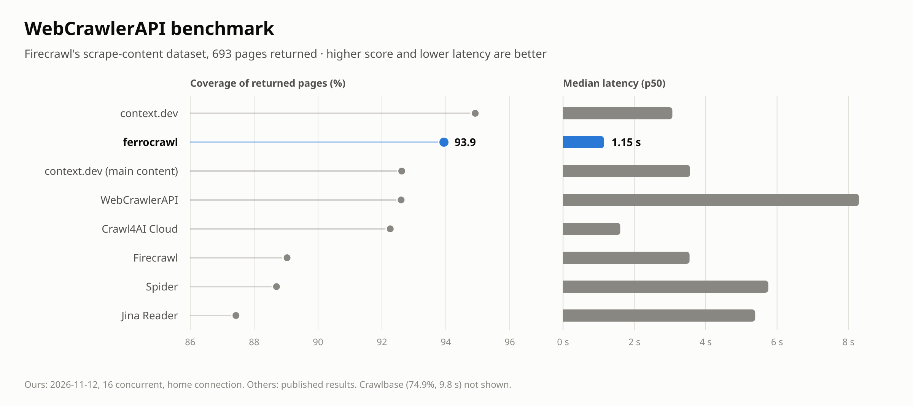
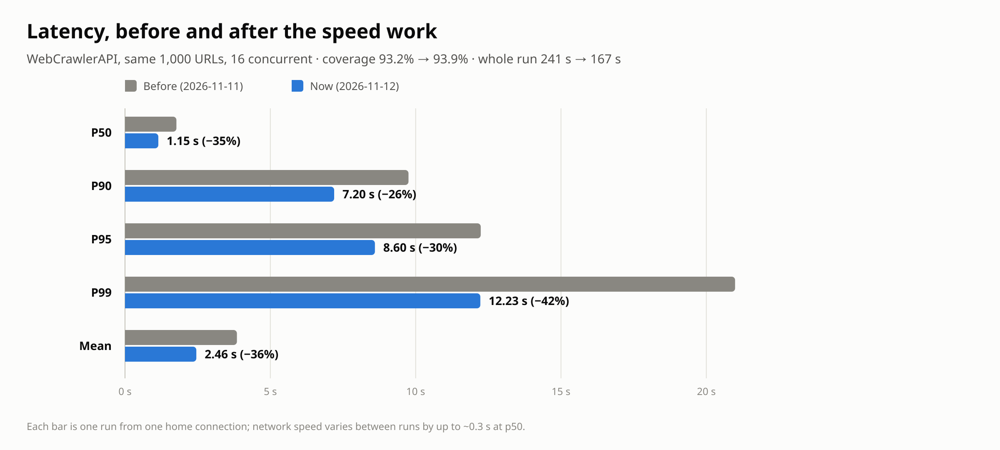
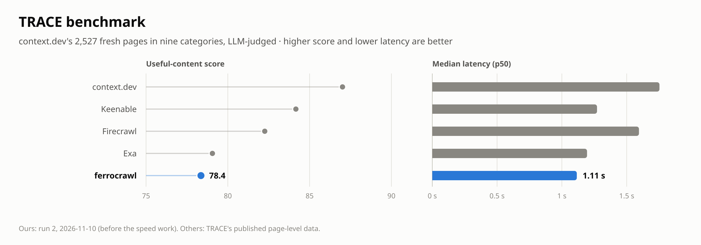

# ferrocrawl

A fast web scraper in Rust. It turns pages into clean Markdown for LLMs, and can crawl and map whole sites. It comes as a CLI, a Firecrawl-style HTTP API, an MCP server for AI agents and a desktop app built with [Rune](https://github.com/anomalyco/rune).

<picture>
  <source media="(prefers-color-scheme: dark)" srcset="benchmarks/img/webcrawlerapi-dark.png">
  
</picture>

The full numbers, the method and the raw per-page results are in [Benchmarks](#benchmarks).

## Why it's fast

- **No browser unless a page needs one.** Pages come over one pooled HTTP/2 client with compression. Headless Chromium starts on first need, and only for pages that look client-rendered (an empty `#root`/`#__next` shell, or "enable JavaScript" with no text). `--render always` forces it.
- **A streaming cleaner.** One `lol_html` pass (Cloudflare's rewriter) drops scripts and styles, makes links and images absolute, un-lazies images and collects links. Then `html5ever` picks the main content, and `htmd` writes the Markdown on Tokio's blocking pool.
- **The crawl streams.** Up to N pages are in flight at once, and each result goes out as soon as it lands. Sitemaps seed the queue. Duplicate URLs are dropped after normalizing them.
- **A shared cache.** Identical requests made at the same time share one fetch (moka), bounded by bytes.
- **Failures fail fast.** A host with no DNS record or no TCP connection fails at once instead of waiting for a browser. So does a hard block (a captcha wall, a WAF deny page), which a browser on the same machine would get too. JavaScript challenges still get the browser, since it sometimes gets past them.
- **Lean renders.** The browser loads no images, fonts, video or ad and analytics scripts. A render stops as soon as the page's text stops changing, not when the last tracker finishes loading. A page that still shows a loading spinner gets a few seconds to fill in.

Measured from a home connection (`--release`):

| Job | Result |
| --- | --- |
| Scrape one MDN page | 163 ms total (149 ms network, 13 ms extract) |
| Crawl the whole Rust Book (113 pages) | 0.76 s, 149 pages/s |
| Crawl MDN HTTP docs, 300 pages | 2.4 s, 125 pages/s |
| Crawl Python stdlib docs, 328 pages | 3.3 s, 100 pages/s |

## Use

```sh
cargo build --release                        # CLI + server (no GUI deps)
cargo build --release -p ferrocrawl-app      # the Rune desktop app

ferrocrawl scrape https://example.com                    # Markdown to stdout
ferrocrawl scrape https://example.com -f json            # markdown, html, text, links, metadata
ferrocrawl crawl https://doc.rust-lang.org/book/ -l 500 -o book/   # one .md per page
ferrocrawl crawl https://site.dev -l 100 > pages.ndjson  # NDJSON stream
ferrocrawl map https://site.dev --search blog
ferrocrawl serve -a 127.0.0.1:3002
ferrocrawl-app                                           # desktop app
```

`crawl` keeps to pages under the start URL's path. `--entire-domain` lifts that, and `--include`/`--exclude-path` take regexes. It respects `robots.txt` unless you pass `--ignore-robots`.

## HTTP API

```sh
curl -X POST localhost:3002/v1/scrape -H 'content-type: application/json' \
  -d '{"url":"https://example.com","formats":["markdown","links"]}'
curl -N -X POST localhost:3002/v1/crawl -d '{"url":"https://site.dev","limit":100}' -H 'content-type: application/json'
curl -X POST localhost:3002/v1/map -d '{"url":"https://site.dev"}' -H 'content-type: application/json'
```

`/v1/crawl` streams NDJSON: one `{"type":"page",...}` line per page, then `{"type":"done","summary":{...}}`. Closing the connection stops the crawl. Set `FERROCRAWL_API_KEY` to require `Authorization: Bearer <key>`.

Scrape options (camelCase, all optional): `formats` (`markdown`, `html`, `rawHtml`, `links`, `text`), `onlyMainContent`, `render` (`auto`, `always`, `never`), `timeoutMs`, `waitForMs`, `maxAgeMs`, `excludeTags`.

`POST /v1/batch/scrape` takes `{"urls": [...], ...scrape options}` and scrapes 16 at a time, returning results in request order.

## Warm intros

`ferrocrawl intro` builds a graph of who knows whom and ranks the ways to reach a person or a firm: "ask Guy A, who's connected to the partner you want."

```sh
ferrocrawl intro me "Your Name"
ferrocrawl intro import Connections.csv                       # your LinkedIn data export
ferrocrawl intro import guy-a.csv --owner "Guy A"             # a network a friend shared with you
ferrocrawl intro know me "Sam Lee" --note "college roommate"  # relationships you know about
ferrocrawl intro harvest https://www.sequoiacap.com/our-team/            # partners → works at Sequoia
ferrocrawl intro harvest https://www.sequoiacap.com/our-companies/       # portfolio → invested in
ferrocrawl intro harvest https://conf.dev/speakers --relation people -l 20
ferrocrawl intro path "Sequoia"            # or a person, an email, a LinkedIn URL, #id
ferrocrawl intro show "Pat Grady"
```

```
1. ask Guy Alpha  (score 0.18)
   You —LinkedIn connection→ Guy Alpha —LinkedIn connection→ Pat Grady —works at→ Sequoia Capital
2. ask Riya Shah  (score 0.13)
   You —LinkedIn connection→ Riya Shah —works at→ Stripe —portfolio link→ Sequoia Capital
```

LinkedIn is only one source. `intro import` reads a file based on its type, and real interaction counts for more than a LinkedIn click:

| Source | How to get it | What it adds |
| --- | --- | --- |
| Email `.mbox` | takeout.google.com → Mail | People you've written to, weighted by how many messages. People who share small threads, who likely know each other. Work domains map to companies. |
| Calendar `.ics` | Google Calendar → Import & export, or Takeout | People you've met, weighted by how many meetings. Co-attendees of small meetings. |
| Contacts `.vcf` | Phone, Google or iCloud → Export vCard | Everyone you saved, with their company. |
| LinkedIn `Connections.csv` | Settings → Data privacy → Get a copy of your data | First-degree connections, yours and friends'. |
| GitHub | `ferrocrawl intro github owner/repo`, an org, or a user (`--mine` for yours) | Contributors to the same repos, an org's members. Set `GITHUB_TOKEN` for higher rate limits. |
| Public pages | `ferrocrawl intro harvest <url>` | Team pages, portfolios, speaker lists. |

Use `--me-email` to tell `.mbox` and `.ics` imports which addresses are yours. Otherwise they pick the address that appears on the most messages. Large group threads, all-hands meetings and role addresses (noreply@, support@) are ignored.

The desktop app has an **Intro** tab with four actions: Find, Harvest, Import and GitHub. It shows the ranked routes, the evidence for each hop, and a drafted intro request you can copy. `FERROCRAWL_MODE=intro scripts/run-app.sh` opens the app straight on that tab.

Where the data comes from:

- **Your connections.** Use LinkedIn's own export: Settings → Data privacy → Get a copy of your data → Connections. Any contacts CSV with name, company and email columns also works.
- **Friends' networks.** They export their own `Connections.csv` and share it with you. This is how you learn that Guy A knows Guy B.
- **Public pages.** Team pages, portfolio pages and speaker lists are read with JSON-LD `Person` data, or by spotting repeated name cards. A team page takes about 0.2 to 3 s.

LinkedIn itself is never scraped. Logged-in scraping breaks LinkedIn's terms and gets accounts restricted, and your account is the network you're trying to use. `harvest` refuses linkedin.com URLs.

How paths are ranked:

- Each edge has a strength: hand-added "knows" 0.85, works at 0.6, LinkedIn connection 0.55, portfolio 0.4, listed on a page 0.3.
- A path's score is the product of its edge strengths.
- Passing through a large organization costs extra, since sharing an employer with 5,000 people says little.
- You get the best route through each of your contacts, so the results are different people to ask, not near-duplicate paths.
- Records are merged by LinkedIn URL, then email, then name. A name only merges when it's unambiguous.

The graph lives in SQLite at `~/.local/share/ferrocrawl/intro.db`. Change it with `--db` or `FERROCRAWL_INTRO_DB`.

## For AI agents (MCP)

`ferrocrawl mcp` is a Model Context Protocol server on stdio:

```sh
claude mcp add ferrocrawl -- ferrocrawl mcp
```

Tools: `scrape`, `batch_scrape` (16 in parallel), `crawl`, `map`, `find_intro_path`, `search_people`, `show_node`, `harvest_people`, `add_connection`, `import_connections` (csv, vcf, mbox, ics), `github_network`, `graph_stats`. An agent can be asked "who can introduce me to someone at Index Ventures?" It harvests the firm's team page, then calls `find_intro_path` and gets back whom to ask, with evidence for every hop.

## Desktop app

Type a URL and pick Scrape, Crawl or Map, then rendering (Auto, HTTP or Browser) and a page limit. Pages stream into the list with timing, size, word count and a JS badge when the browser rendered them. The right side shows the rendered Markdown or the raw source, with Copy. Use ↑/↓ to move through pages and Esc to stop. `ferrocrawl-app --snap out.png --scene demo` renders it headlessly.

## On a machine with little RAM

Build and run through the scripts. Each runs in its own memory-capped systemd scope, so if one
runs out, only it is killed, not your terminal or desktop session:

```sh
scripts/build.sh -p ferrocrawl-app          # cargo build --release, capped (FERROCRAWL_BUILD_MEM, default 2.5G)
scripts/run-app.sh                          # the desktop app, capped (FERROCRAWL_APP_MEM, default 2G)
FERROCRAWL_BENCH=trace scripts/run-app.sh   # open straight into a benchmark (add FERROCRAWL_BENCH_RUN=1 to start it)
```

Headless Chromium moves itself into its own systemd scope; ferrocrawl caps that scope at 1.2 GB
(`FERROCRAWL_CHROME_MEM`) and starts a fresh browser if it gets killed. Plain `--release` builds
skip LTO to keep the linker small; `--profile dist` is the fully optimized build.

## Benchmarks

Two public benchmarks, each scored with its own method. The full tables, caveats and every saved run (per-page results, scores, judge verdicts) are in [`benchmarks/RESULTS.md`](benchmarks/RESULTS.md).

**[WebCrawlerAPI](benchmarks/RESULTS.md#webcrawlerapi)**: Firecrawl's public `scrape-content-dataset-v1`, 1,000 URLs, scored by how much of each page's known text comes back.

| Provider | Coverage | p50 | p95 |
| --- | --- | --- | --- |
| context.dev | 94.9% | 3.07 s | 17.2 s |
| **ferrocrawl** | **93.9%** | **1.15 s** | **8.6 s** |
| context.dev (main content) | 92.6% | 3.56 s | 29.8 s |
| WebCrawlerAPI | 92.6% | 8.30 s | 49.3 s |
| Crawl4AI Cloud | 92.3% | 1.60 s | 31.0 s |
| Firecrawl | 89.0% | 3.55 s | 16.0 s |

<picture>
  <source media="(prefers-color-scheme: dark)" srcset="benchmarks/img/speed-dark.png">
  
</picture>

**[TRACE](benchmarks/RESULTS.md#trace)**: context.dev's 2,527 fresh pages in nine categories, judged by an LLM for useful content. Our run predates the speed work above.

<picture>
  <source media="(prefers-color-scheme: dark)" srcset="benchmarks/img/trace-dark.png">
  
</picture>

Our numbers come from one laptop on a home connection; the other providers' come from each benchmark's published results. Rerun them yourself:

```sh
ferrocrawl bench run webcrawlerapi -c 16      # ~3 minutes; prints the leaderboard
ferrocrawl bench rescore <run dir>            # re-extract saved HTML with the current code, no network
python3 scripts/bench_charts.py               # redraw benchmarks/img/ from the saved runs
```

The app's Benchmark tab runs them too.

## Layout

- `crates/core`: the engine (`fetch`, `extract`, `render`, `pdf`, `crawl`, `map`, `urls`, `bench`)
- `crates/intro`: the warm-intro graph (`linkedin` import, `harvest` from public pages, `path` ranking)
- `crates/cli`: CLI, HTTP server and MCP server
- `crates/app`: the Rune app

## Tests

```sh
cargo test                                         # offline unit tests
cargo test --release -p ferrocrawl-app -- --ignored   # live crawl/map through the app state
```

## Not yet

DOCX parsing, proxy rotation, screenshots, LLM extraction (`/extract` with a JSON schema), and persistent async crawl jobs. ferrocrawl won't try to get past captchas or bot walls; a site that blocks it is reported as blocked.

## Contributing

Issues and pull requests are welcome. Run `cargo test` before sending one. If a change touches extraction, include a `ferrocrawl bench rescore` before and after on a saved run, so the effect on quality is visible. Scores should not drop.

## License

Licensed under either of [Apache License, Version 2.0](LICENSE-APACHE) or [MIT license](LICENSE-MIT), at your option.

Unless you explicitly state otherwise, any contribution intentionally submitted for inclusion in ferrocrawl by you, as defined in the Apache-2.0 license, shall be dual licensed as above, without any additional terms or conditions.
